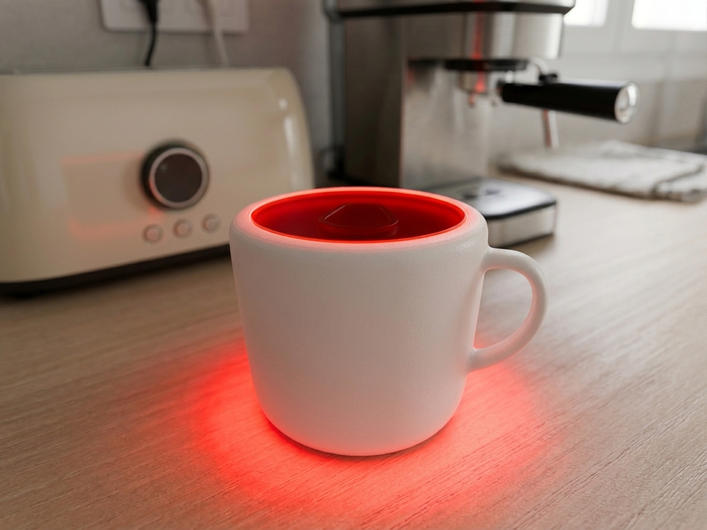

# CoFilled · ESPHome

A water tank sensor designed to attach to a coffee machine's water reservoir and alert you when it runs out of water. A red light inside a **coffee cup-shaped enclosure** provides a visible reminder to refill the tank.

CoFilled uses an **ESP32-C3**, **ESPHome**, and two **WS2812** LEDs. It also publishes the tank status to Home Assistant.

## Useful links

### Where to buy the components

| Component | AliExpress | Amazon Spain |
| --- | --- | --- |
| Water tank sensor | [Buy on AliExpress](https://s.click.aliexpress.com/e/_c2I1zExd) | [Buy on Amazon](https://www.amazon.es/dp/B07XY75W2R?tag=aguacatec-21) |
| ESP32-C3 board | [Buy on AliExpress](https://s.click.aliexpress.com/e/_c352cM11) | [Buy on Amazon](https://www.amazon.es/dp/B0CHYHGYRH?tag=aguacatec-21) |
| LED strip | [Buy on AliExpress](https://s.click.aliexpress.com/e/_c2QpZtah) | [Buy on Amazon](https://www.amazon.es/dp/B01CDTED80?tag=aguacatec-21) |

### Enclosure and setup guide

- [Download the coffee cup enclosure STL files on Patreon](https://www.patreon.com/AguacaTEC/posts/cofilled-sensor-170427324).
- [Find the complete CoFilled setup guide on AguacaTEC](https://aguacatec.es/?s=cofilled).
